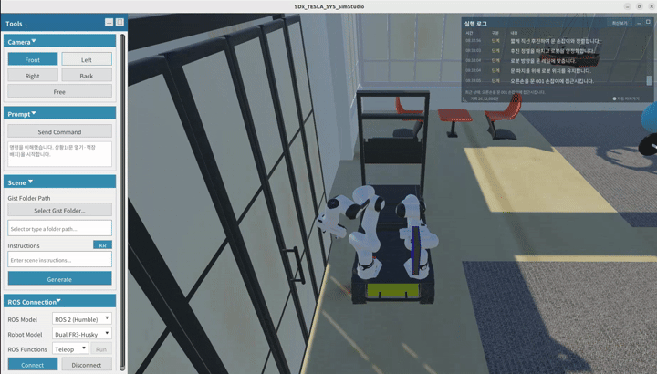
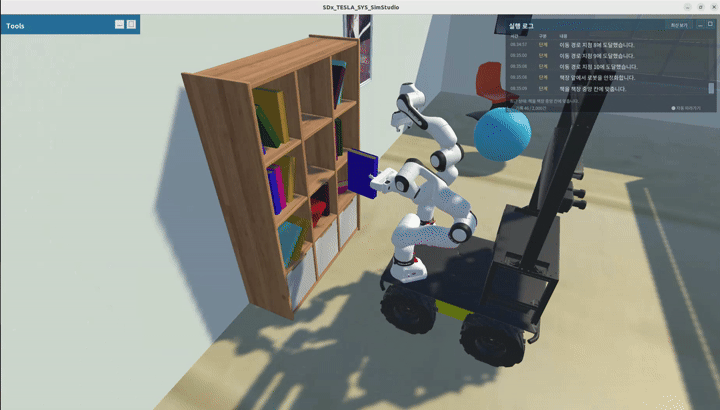

# SDx_TESLA_SYS

<!-- BEGIN SDx simulation media -->
<table>
  <tr>
    <td colspan="2" align="center">
      <a href="docs/media/SDx_TESLA_SYS_SimStudio_main.png">
        
      </a>
      <br>
      <sub>SDx_TESLA_SYS_SimStudio 시뮬레이터 실행 화면</sub>
    </td>
  </tr>
  <tr>
    <th align="center" width="50%">동작 시연 1</th>
    <th align="center" width="50%">동작 시연 2</th>
  </tr>
  <tr>
    <td align="center" valign="top" width="50%">
      <a href="docs/media/SDx_TESLA_SYS_SimStudio_1.gif">
        
      </a>
    </td>
    <td align="center" valign="top" width="50%">
      <a href="docs/media/SDx_TESLA_SYS_SimStudio_2.gif">
        
      </a>
    </td>
  </tr>
</table>
<!-- END SDx simulation media -->

Unity와 MuJoCo를 연동한 Dual FR3–Husky 시뮬레이터입니다.  
이 문서는 **Ubuntu용 독립 실행 배포본**인 `SDx_TESLA_SYS_SimStudio_Release`의 실행 방법을 설명합니다.  
실행 PC에는 Unity Editor와 Unity Hub를 설치하지 않아도 됩니다.  

## 실행 환경

- Ubuntu 22.04 x86-64 데스크톱과 정상 동작하는 그래픽 드라이버
- Python 3, 한글 폰트, Git LFS
- 자연어 명령 사용 시 Ollama와 `qwen3:4b` 모델

MuJoCo 네이티브 라이브러리는 배포본에 포함됩니다.  
모델은 별도로 다운로드하며, 프로그램은 모델 설치나 다운로드를 자동으로 수행하지 않습니다.  

## 1. 기본 패키지 설치

```bash
sudo apt update
sudo apt install -y git git-lfs curl ca-certificates python3 fonts-noto-cjk zstd
git lfs install
```

## 2. 배포본 다운로드

처음 내려받는 경우 다음 명령을 실행합니다.  

```bash
mkdir -p "$HOME/Applications"
cd "$HOME/Applications"

GIT_LFS_SKIP_SMUDGE=1 git clone --depth 1 \
  https://github.com/SDxSim-ETRI/SDx_TESLA_SYS.git

cd SDx_TESLA_SYS

git lfs pull \
  --include="SDx_TESLA_SYS_SimStudio_Release/**" \
  --exclude=""
```

이 명령은 소스의 대형 에셋 대신 **실행 배포본의 LFS 파일만** 내려받습니다.  
Git LFS를 생략하면 실행 파일이나 데이터가 실제 파일이 아닌 작은 포인터 파일로 남을 수 있습니다.  
GitHub의 `Download ZIP` 대신 위 방법을 사용하세요.  

## 3. Ollama 설치

이미 설치되어 있으면 이 단계는 건너뜁니다.  

```bash
curl -fsSL https://ollama.com/install.sh | sh
ollama --version
```

공식 설치 프로그램이 시스템 Ollama 서비스(`11434`)를 시작할 수 있습니다.  
이 프로그램에서 사용하는 전용 Ollama(`11435`)와는 별개이며, 기존 시스템 서비스를 삭제하거나 설정을 변경할 필요는 없습니다.  

## 4. Qwen3 4B 모델 준비 — 최초 한 번

모델 저장 위치는 다음과 같습니다.  

```text
~/.local/share/sdx-simstudio/ollama-models
```

**일반 사용자 계정으로 모델을 준비합니다. `sudo ollama`를 사용하지 마세요.**  
이 위치에 `qwen3:4b`가 이미 준비되어 있으면 재설치하지 않아도 됩니다.  

### 터미널 A: 모델 다운로드용 임시 서버 시작

Unity Editor의 Play와 시뮬레이터를 종료한 상태에서 실행합니다.  

```bash
mkdir -p "$HOME/.local/share/sdx-simstudio/ollama-models"

OLLAMA_HOST=127.0.0.1:11436 \
OLLAMA_MODELS="$HOME/.local/share/sdx-simstudio/ollama-models" \
OLLAMA_NO_CLOUD=1 \
ollama serve
```

이 터미널은 그대로 둡니다.  
`address already in use` 등 시작 오류가 있다면 다음 단계로 진행하지 말고 `11436` 포트 사용 여부를 확인하세요.  

### 터미널 B: 모델 다운로드와 확인

새 터미널에서 다음을 실행합니다.  

```bash
OLLAMA_HOST=127.0.0.1:11436 ollama pull qwen3:4b
OLLAMA_HOST=127.0.0.1:11436 ollama list
```

목록에 `qwen3:4b`가 표시되면 **터미널 A에서 `Ctrl+C`**를 눌러 임시 서버를 종료합니다.  
다운로드한 모델은 그대로 남습니다.  

`OLLAMA_MODELS`는 모델을 저장하는 **서버를 시작할 때** 지정해야 합니다.  
위의 임시 서버를 사용하는 이유는 시스템 서비스의 모델 폴더 대신 현재 사용자가 읽을 수 있는 폴더에 모델을 저장하기 위해서입니다.  

## 5. 배포본 설정 확인

다음 파일을 확인합니다.  

```text
SDx_TESLA_SYS_SimStudio_Release/Tools/SDxLLMGateway/play_settings.json
```

아래 항목을 사용합니다.  
이는 확인할 항목의 예시이며, 파일의 다른 설정은 그대로 유지합니다.  

```json
{
  "model": "qwen3:4b",
  "ollama_mode": "private",
  "models_path": "~/.local/share/sdx-simstudio/ollama-models",
  "ollama_executable": "",
  "gateway_port": 8765,
  "private_ollama_port": 11435
}
```

`~`는 실행하는 사용자의 홈 폴더로 해석됩니다.  
모델을 다른 위치에 준비했다면 `models_path`를 실제 위치로 지정하세요.  
Ollama 실행 파일을 표준 위치가 아닌 곳에 설치했다면 `ollama_executable`도 해당 PC에 맞춰 지정해야 합니다.  

## 6. 시뮬레이터 실행

Unity Editor의 Play나 별도 Gateway가 실행 중이라면 먼저 종료합니다.  

```bash
cd "$HOME/Applications/SDx_TESLA_SYS/SDx_TESLA_SYS_SimStudio_Release"

chmod +x SDxSimStudio_Linux.x86_64
bash ./Run_SDxSimStudio.sh
```

프로그램이 시작되면 설치된 Ollama와 Gateway를 자동으로 시작합니다.  
`LLM 준비 완료 (qwen3:4b)` 메시지가 표시된 뒤 자연어 명령을 입력하세요.  

실행 스크립트 없이 직접 실행하고 터미널에서 로그를 확인하려면 다음을 사용합니다.  

```bash
./SDxSimStudio_Linux.x86_64 \
  -screen-fullscreen 0 \
  -screen-width 1600 \
  -screen-height 900 \
  -logFile -
```

프로그램은 **일반 사용자 계정으로 실행**합니다. `sudo`로 실행하지 마세요.  

## 7. 사용 방법과 종료

Enter 또는 **Send Command**로 명령을 입력합니다.  

직접 실행 명령:

```text
상황1
```

자연어 명령 예시:

```text
테이블 위에 있는 책을 서재에 있는 책꽂이에 꽂아라
```

`상황1`은 책 파지 → 문 개방 → 방 사이 이동 → 책장 배치 순서로 진행됩니다.  
직접 입력하는 `상황1`은 LLM 없이도 사용할 수 있으며, 자연어 명령에는 모델 준비가 필요합니다.  

프로그램 창을 정상적으로 닫으면 **이번 실행에서 시작한** Gateway와 전용 Ollama를 정리합니다.  
기존 시스템 Ollama 서비스나 외부에서 시작한 서비스를 재사용한 경우에는 해당 외부 서비스를 종료하지 않습니다.  

## 문제 해결

| 증상 | 확인 사항 |
|---|---|
| 실행 파일이 실행되지 않거나 작은 텍스트 파일임 | Git LFS 다운로드 여부, 파일 실행 권한, x86-64 환경 확인 |
| `DllNotFoundException: mujoco` | 배포본 내 `libmujoco.so`와 동적 라이브러리 의존성 확인 |
| `start_script_missing` | 실행 파일 옆의 `Tools/SDxLLMGateway/start_play.sh` 확인 |
| `ollama_not_installed` | Ollama 설치 및 실행 파일 경로 확인 |
| 모델을 찾지 못하거나 접근 권한 오류 | 4번 사용자 전용 모델 준비와 `models_path` 확인 |
| 한글이 네모로 표시됨 | `fonts-noto-cjk` 설치 후 프로그램 재실행 |
| 포트 충돌 | Editor Play, 다른 배포본, 수동 Gateway의 동시 실행 여부 확인 |

배포 폴더에서 라이브러리를 점검할 수 있습니다.  

```bash
file SDxSimStudio_Linux.x86_64 UnityPlayer.so
find SDxSimStudio_Linux_Data -name 'libmujoco.so' -exec ldd {} \;
ldd UnityPlayer.so
```

`ldd` 결과에 `not found`가 있으면 해당 시스템 라이브러리가 필요합니다.  
최상위 실행 파일, `UnityPlayer.so`, `_Data`, `Tools`와 Unity가 생성한 나머지 필수 파일은 함께 유지하세요.  

## 저장소 구성

```text
SDx_TESLA_SYS/
├── docs/
│   └── media/
│       ├── SDx_TESLA_SYS_SimStudio_main.png
│       ├── SDx_TESLA_SYS_SimStudio_1.gif
│       └── SDx_TESLA_SYS_SimStudio_2.gif
├── SDx_TESLA_SYS_SimStudio/          # 개발용 Unity 프로젝트
├── SDx_TESLA_SYS_SimStudio_Release/  # Ubuntu 독립 실행 배포본
├── LICENSE
└── README.md
```

위 구조는 주요 항목만 표시합니다.  
소스 프로젝트를 Unity에서 열거나 다시 빌드하지 않아도 배포본을 실행할 수 있습니다.  

## 참고 문서

- [Ollama Linux 설치](https://docs.ollama.com/linux)
- [Ollama 모델 저장 위치](https://docs.ollama.com/faq#where-are-models-stored)
- [Qwen3 4B](https://ollama.com/library/qwen3:4b)
- [Git LFS](https://docs.github.com/en/repositories/working-with-files/managing-large-files/about-git-large-file-storage)
